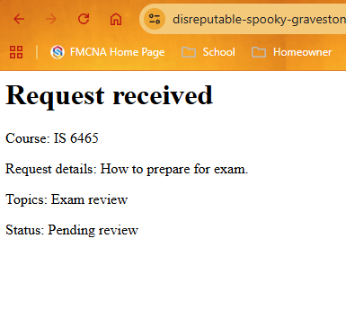

# Lab 4: Guided Application Walkthrough and Testing

## Part 1: Run the Application

I opened the Peer Tutoring Hub application using GitHub Codespaces and accessed the tutoring request form through `request-form.php`.

I completed the form by selecting a course, entering a reason for requesting tutoring, choosing at least one topic, and selecting a preferred date and time.

After submitting the form, the application processed the information and accepted my tutoring request. This showed that the values I entered passed the application's validation checks.

The application displayed a confirmation indicating that my request was accepted.

### Screenshot Evidence

## Part 2: Trace the Templates

### 1. What content does `header.php` provide to every page?

The `header.php` file provides the basic HTML structure that is shared across the application's pages. It defines the document type, language, character encoding, and viewport settings. It also links the Bootstrap stylesheet and the application's custom CSS file.

In addition, it sets the browser title to "Peer Tutoring Hub" and opens the body section where the webpage content is displayed. Using a shared header helps keep the pages consistent and makes the application easier to maintain.

### 2. What content does `nav.php` provide?

The `nav.php` file provides the navigation bar for the Peer Tutoring Hub application. It displays the application name and includes links to the home page (`index.php`), the requests page (`requests.php`), and the tutoring request form (`request-form.php`).

The navigation bar uses Bootstrap classes for styling and responsive layout. By keeping the navigation in a shared file, the application can provide consistent navigation across multiple pages and make future updates easier.

### 3. What content does `footer.php` provide?

The `footer.php` file provides the footer section that is shared across the application's pages. It displays the "Peer Tutoring Hub" text at the bottom of the page and uses Bootstrap classes to control the spacing, border, and text alignment.

The file also loads the Bootstrap JavaScript bundle, which supports interactive components. Finally, it closes the HTML body and document tags that were opened in `header.php`. Using a shared footer helps maintain a consistent layout across the application.

### 4. Why is `require_once` appropriate for these files?

The `require_once` statement allows PHP pages to include shared files such as `header.php`, `nav.php`, and `footer.php`. It ensures that each file is loaded only once during a request, preventing duplicate content.

It is appropriate because these files provide important parts of the webpage structure. If a required file is missing, PHP stops execution instead of continuing without it. This approach also improves code reusability and makes the application easier to maintain.

### 5. Where is the shared CSS file linked?

The shared CSS file is linked inside the `<head>` section of `includes/header.php` using the `<link>` element. The file is located at `css/styles.css`.

Since `header.php` is included in the application's pages, the stylesheet can provide consistent styling across those pages.

## Part 3: Observe the form controls

### 1. `reason`

The `reason` control uses a textarea that allows students to explain what they need help with during their tutoring session. The field is required and has a maximum length of 500 characters.

When the form is submitted, PHP receives the entered information as a string through `$_POST['reason']`. The textarea allows the student to provide a more detailed explanation rather than selecting from predefined options.

### 2. `topics[]`

The `topics[]` control uses checkboxes that allow students to select multiple topics for their tutoring session. The available options are Exam review, Practice problems, and Study plan.

When the form is submitted, PHP receives the selected topics as an array of strings through `$_POST['topics']`. The square brackets in `topics[]` allow multiple selected values to be grouped together instead of submitting only one value.

### 3. `preferredtime`

The `preferredtime` control uses radio buttons that allow students to select their preferred tutoring time. The available options are Morning, Afternoon, and Evening.

Since all three radio buttons share the same name, students can only select one option. When the form is submitted, PHP receives the selected time as a single string through `$_POST['preferredtime']`. The field is required so that students must select a preferred time before submitting the form.

### 4. `preferreddate`

The `preferreddate` control uses an HTML date input that allows students to select their preferred tutoring date. The field is required, meaning the student must select a date before submitting the form.

When the form is submitted, PHP receives the selected date as a string through `$_POST['preferreddate']`, formatted as YYYY-MM-DD. The application must validate the submitted date to ensure it meets the business rule that tutoring requests cannot be scheduled in the past.

### 5. `form_name`

The `form_name` control is a hidden input field that identifies the submitted form. It sends the value `tutoring_request` to PHP as a string. Since the field is hidden, the user does not need to enter or select anything.

## Part 4: Test Validation Behavior

### Test 1: Valid Request

**Values entered:**
- Course: IS 6465
- Reason: How to prepare for final exam.
- Topics: Exam Review
- Preferred time: Evening
- Preferred date: 11/02/2026

**Result:** Accepted

**Message displayed:**
Request received

**Business rule:**
The tutoring request must contain a valid course, a reason between 10 and 500 characters, at least one valid topic, and a valid preferred time. The preferred date must be today or a future date.

**Observation:**
I completed the tutoring request form using valid information and submitted it through the application. The request was accepted, and a confirmation message was displayed. This demonstrates that the application accepts submitted information when all required fields and business rules are satisfied.

### Test 2: Missing or Invalid Value

**Values entered:**
- Course: IS 6465
- Reason: Help me!
- Topics: Study Plan
- Preferred time: Morning
- Preferred date: 11/01/2026

**Result:** Rejected

**Message displayed:**
"Describe your request using 10 to 500 characters."

**Business rule:**
The reason for requesting tutoring must contain between 10 and 500 characters after removing leading and trailing whitespace.

**Observation:**
I submitted the tutoring request with only eight characters in the reason field. The application rejected the request and displayed a validation message explaining the minimum and maximum character requirements. This demonstrates that the server validates the submitted information before accepting the request.

### Test 3: Past Date

**Values entered:**
- Course: IS 6465
- Reason: Help me study for my final exam, please.
- Topics: Study Plan
- Preferred time: Morning
- Preferred date: 2026-10-27

**Result:** Rejected

**Message displayed:** Preffered date cannot be in the past.

**Business rule:**
The preferred tutoring date must be today or a future date. Requests with dates in the past are not allowed.

**Observation:**
I submitted the request using the day before as the date. The application rejected the request and displayed a message
explaining that I cannot use a past date. 

## Part 5: Review Testing and CRUD Pages

### 1. Validation Test Results

I opened `tests/validation-tests.php` in my browser to execute the provided validation tests.

The application displayed the following results:

- Valid time: PASS
- Missing time: PASS
- Altered value: PASS
- Multiple valid topics: PASS
- Missing topics: PASS
- Altered topic: PASS
- Minimum length: PASS
- Maximum length: PASS
- Too short: PASS
- Too long: PASS

**Overall Result:** 10 out of 10 tests passed.

**Observation:**

All ten validation tests passed successfully. The tests verified that the application correctly handles valid and invalid preferred times, multiple or missing tutoring topics, altered values, and the minimum and maximum character requirements for the reason field.

These results demonstrate that the validation functions behave as expected for the test cases provided. The tests also show the importance of server-side validation in preventing invalid information from being accepted.

### 2. CRUD Pages

I opened `requests.php` and viewed the list of tutoring requests. The page displayed request numbers, courses, preferred dates, and statuses.

I selected Request 13 and opened its details page. The page displayed information about the tutoring request, including the course, reason, preferred date, preferred time, topics, and status. It also provided options to edit or cancel the request.

| CRUD Action | Page |
|---|---|
| Create | `request-form.php` |
| Read one request | `request-details.php` |
| Read all requests | `requests.php` |
| Update | `edit-request.php` |
| Delete | `delete-request.php` |

### 3. What query parameter appears in the request details URL?

The query parameter is `request_id`. When I opened Request 13, the URL contained `request-details.php?request_id=13`. The parameter identifies which tutoring request the application should display.

### 4. Why is a GET query parameter appropriate for viewing one request?

A GET query parameter is appropriate because the application is retrieving information rather than modifying it. The `request_id` parameter allows the application to identify and display a specific tutoring request. It also allows users to access a particular request through a URL.

### 5. Why should an actual update or delete later use POST rather than GET?

Actual update and delete operations should use POST because they modify application data. GET requests are intended for retrieving information and should not change records. Using POST helps prevent accidental modifications or deletions,