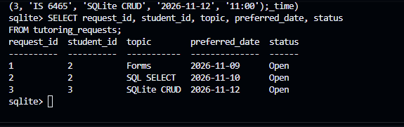
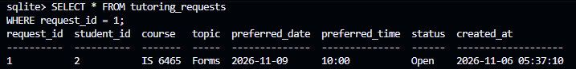
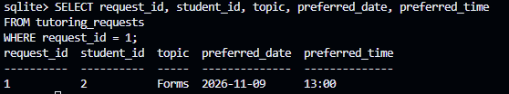
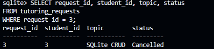
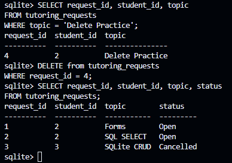

# Lab 5: Build and Query the Peer Tutoring Hub Database

## Part 1: Create the database tables

1. Screenshot Evidence

2. Which column is the primary key in each table? 
- student_id identifies each student, while request_id identifies each tutorin request.

3. Which column is the foreigh key, and what relationship does it represent? 
- student_id in tutoring_requests references student_id in students. This connects each request to its student. 

4. Why is student_email marked UNIQUE?
- Prevents two student records from having the same email address.

## Part 2: Insert students and tutoring requests

1. Screenshot Evidence

2. SELECT * FROM students; and SELECT * FROM tutoring_requests;

3. Jordan has one student row because each student only needs to be registered once in the database. But, Jordan has two
tutoring request rows because he submitted two seperate requests, and both are connected to his student record through
student_id. 

## Part 3: Read the Stored Data

Join Query:

 SELECT
  r.request_id,
  s.student_name,
  s.student_email,
  r.course, r.topic,
  r.preferred_date, r.preferred_time, r.status
FROM tutoring_requests AS r
JOIN students AS s ON r.student_id = s.student_id
ORDER BY r.preferred_date;

1. What does the JOIN condition connect?

The JOIN condition connects the student_id column in the tutoring_requests table to the student_id column in the 
students table.

2. What is the difference between JOIN and WHERE?

JOIN is used to combine related information from two tables, while WHERE is used to filter records based on a specific condition.

3. Why should the application retrieve one request by request_id instead of by topic alone?

The application should use request_id because each request has a unique identifier. Multiple students could submit requests for the
same topic, and this might return multiple records or the wrong request. 

## Part 4: Update One Request

1. Update statement 1: 

UPDATE tutoring_requests
SET preferred_time = '13:00'
WHERE request_id = 1;

Update statement 2: 

UPDATE tutoring_requests
SET status = 'Cancelled'
WHERE request_id = 3;

2. Evidence screenshots before and after:

3. Avery's cancelled screenshot evidence:

4. Why is a specific WHERE clause essential in an UPDATE statement? 

A specific WHERE clause ensures that only the intended record is modified. 

5. Why does the Peer Tutoring Hub use a Cancelled status instead of immediately deleting a real request?

Using Cancelled status allows the application to keep a record of the original tutoring request. This preserves
the request history for tracking. 

## Part 5: Delete One Test Request

1. Insert Statement: 
INSERT INTO tutoring_requests
(student_id, course, topic, preferred_date, preferred_time)
VALUES
(2, 'IS 6465', 'Delete Practice', '2026-11-13', '15:00');

2. Delete Statement:
DELETE from tutoring_requests
WHERE request_id = 4;

3. Screenshot evidence:

4. Why is a WHERE clause essential in a DELETE statement?

The WHERE clause is important becuase it allows us to identify the specific record we want to delete.
Without a WHERE clause, the DELETE statement would remove every record from the table. 

## Part 6: Reflect on the CRUD Workflow

|  CRUD Action	|    SQL Statement	 |     Peer Tutoring Hub example     |
| ------------- | ------------------ | --------------------------------- |
|   Create	    |    INSERT INTO     |	Adding Jordan Lee as a student and creating his tutoring requests. |
|   Read        |      SELECT        |	Retrieving tutoring requests and student information using JOIN. |
|   Update	    |      UPDATE	     |  Changing Jordan's preferred time from 10:00 to 13:00 and changing Avery's status to Cancelled. |
|   Delete	    |    DELETE FROM	 |  Removing the temporary Delete Practice request without affecting other requests. |

1. How does the database preserve the connection between a student and the student's request?

The database maintains the connection between students and tutoring requests through the student_id column. This column
is the primary key in teh students table and a foreign key in the tutoring_requests table.

2. Which database constraint prevents two student rows from using the same email address? 

The UNIQUE constraint prevents two students from having the same email address in the database.

3. What could Happen if an UPDATE or DELETE statement did not include a WHERE clause? 

Without a WHERE clause, an UPDATE statement could modify every record in a table, while a DELETE could remove all records.

4. When the application later receives values from an HTML form, why should PHP send those values as parameters instead
of placing them directly into SQL text? 

PHP should send from values as parameters to help prevent malicious input from changing the query's intended behavior. 