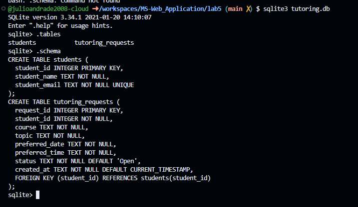

# Lab 5: Build and Query the Peer Tutoring Hub Database

## Part 1: Create the database tables

1. Screenshot Evidence

2. Which column is the primary key in each table? 
- student_id identifies each student, while request_id identifies each tutorin request.

3. Which column is the foreigh key, and what relationship does it represent? 
- student_id in tutoring_requests references student_id in students. This connects each request to its student. 

4. Why is student_email marked UNIQUE?
- Prevents two student records from having the same email address.

## Part 2: Insert students and tutoring requests

