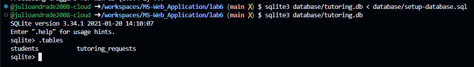
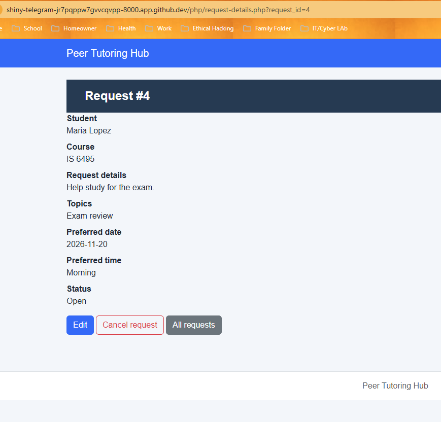
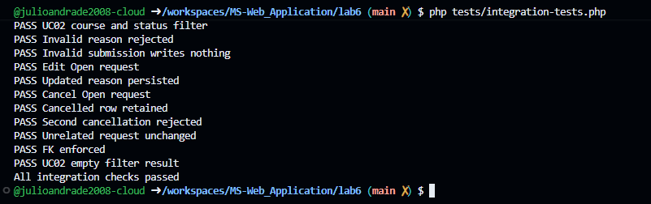

# Lab 6: PHP, PDO, and SQlite Inegration

## Part 1: Set Up the Database

### Screenshot Evidence

## Part 2: Run the Application

1. URL opened: https://shiny-telegram-jr7pqppw7gvvcqvpp-8000.app.github.dev/php/request-form.php
2. The request made was saved under request #4. 
3. See below for screenshot of details page.
### Screenshot Evidence

## Part 3: Test the Application Workflows

| Test | What I Did | Expected Result | Actual Result | Pass or Fail |
|---|---|---|---|---|
| Submit a valid request | Entered valid student information and submitted a tutoring request. | A new request is created with status Open. | The request was saved successfully and displayed with Open status | Pass |
| View all requests | Opened the request list after submitting a request by clicking on All Requests. | The new request appears in the list. | New request appeared with other previous request. | Pass |
| Filter requests | Filtered requests by course and/or status. | Only matching request are displayed. | Matching request appeard after filtering. | Pass |
Edit an Open request | Selected an Open request and updated its information. | The revised values are displayed. | Revised information was properly saved and displayed. | Pass |
Cancel an Open request | Selected an Open request and cancelled it. | The request status changed to Cancelled. | The request was updated to show cancelled accordingly. | Pass |
Edit or Cancel a Cancelled request | Attempt to modify an already cancelled request. | The application does not allow the change. | There was no edit or cancel button available to even select in already cancelled request. | Pass |

## Part 4: Trace the Request Submission Workflow

1. The 'php/request-form.php' file displays the tutoring request form where students enter their information. 
2. The 'php/process-reqest.php' file receives the submitted form data and passes it to the service layer for processing. 
3. The 'php/config/db.php' file establishes the PDO connection between PHP and the SQlite database.
4. The 'php/services/requestService.php' file coordinates input validation and the database transaction to ensure the request is processed correclty. 
5. The 'php/repositories/studentPDO.php' and 'php/repositories/requestPDO.php' files contain SQL statements used to interact with the database.
6. The 'STUDENTS' table stores student information
7. The 'TUTORING_REQUESTS' table stores tutoring request information. 
8. Each tutoring request contains a 'student_id' that acts as a foreign key referencing the 'student_id' primary key in the 'STUDENTS' table. 

### Why SQL Statements Belong in Repository Files

SQL statements belong in repository files because they seperate database operations from the user interface. This makes the application easier to maintain and troubleshoot since each file has a specific responsbility. It also allows database operations to be reused by different parts of the same SQL code. 

## Part 5: Run the Integration Tests

See screenshot below for test output

### Screenshot Evidence

## Part 6: Use the AI Skills Pack Process

### Application Builder

I verified the AI's statement that `services/requestService.php` manages the database transaction. When reviewing the `submitRequest()` function, I found that it uses `beginTransaction()` before saving the student and tutoring request information. The function then uses `commit()` when the operation succeeds and `rollBack()` if an error occurs. This confirms that the AI's explanation matches the actual application code.

### Traceability Auditor

**Prompt:**

Trace the requirement "a student can submit a tutoring request" through the PHP files, service, repositories, SQLite tables, and integration tests in this project.

**AI Response:**

The application uses request-form.php to collect student information and process-request.php to receive the submitted data. The requestService.php file validates the submission and coordinates the database transaction. The repository files use PDO prepared statements to store information in the students and tutoring_requests tables. Integration tests verify that requests are created successfully.

**Traceability Table:**

| Requirement | Application Page | Service or Validation | Repository or SQL | Database Table | Test Evidence |
|---|---|---|---|---|---|
| Student submits a tutoring request | php/request-form.php and php/process-request.php | services/requestService.php - submitRequest() and validateSubmission() | repositories/studentPDO.php and repositories/requestPDO.php | students and tutoring_requests | tests/integration-tests.php - PASS UC01 create and Open |

**Evaluation:**

I verified that process-request.php calls submitRequest() and that the service uses the repository functions to save the information. The database schema also confirms that student_id is a foreign key connecting tutoring requests to students. The integration test results confirmed that a new request was created with Open status.

### Test Harness Generator

**Prompt:**

Suggest one useful test case for the Peer Tutoring Hub application. The test must relate to request creation, filtering, editing, cancellation, validation, or database integrity.

**AI Response:**

The AI suggested testing whether a cancelled tutoring request can be edited. The test should create a request, cancel it, attempt to update it, and verify that the original information remains unchanged.

**Evaluation:**

1. The original integration-tests.php does not directly test whether a cancelled request can be edited. It does test cancellation and rejection of a second cancellation.

2. I would manually create and cancel a tutoring request, then attempt to edit it. I would verify that the application rejects the change and that the original information remains unchanged in SQLite.

3. I believe this is an appropriate test because the application's business rules only allow Open requests to be edited. The updateOpenRequest() function also contains a condition that restricts updates to Open requests.

### Skills Pack Reflection

The AI Skills Pack helped me understand how the different PHP files work together to process tutoring requests and store information in the SQLite database. The Application Builder helped explain the workflow, while the Traceability Auditor helped connect the business requirements to the actual code and integration tests. The Test Harness Generator also helped me identify an additional test that could improve the application's test coverage. I learned that AI-generated responses need to be verified against the actual code and requirements because AI can make assumptions or overlook important details.

## Part 7: Inspect the Database

## Part 7: Inspect the Database

The `JOIN` statement connects the `tutoring_requests` table with the `students` table using the `student_id` column. This allows the query to retrieve information from both tables, such as the student's name and email along with their tutoring request details. The `JOIN` matches records where the student IDs are the same, making it possible to display the student's information without storing it multiple times in the tutoring requests table.