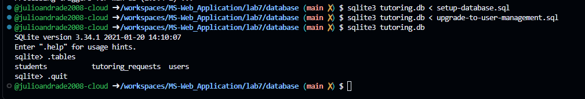
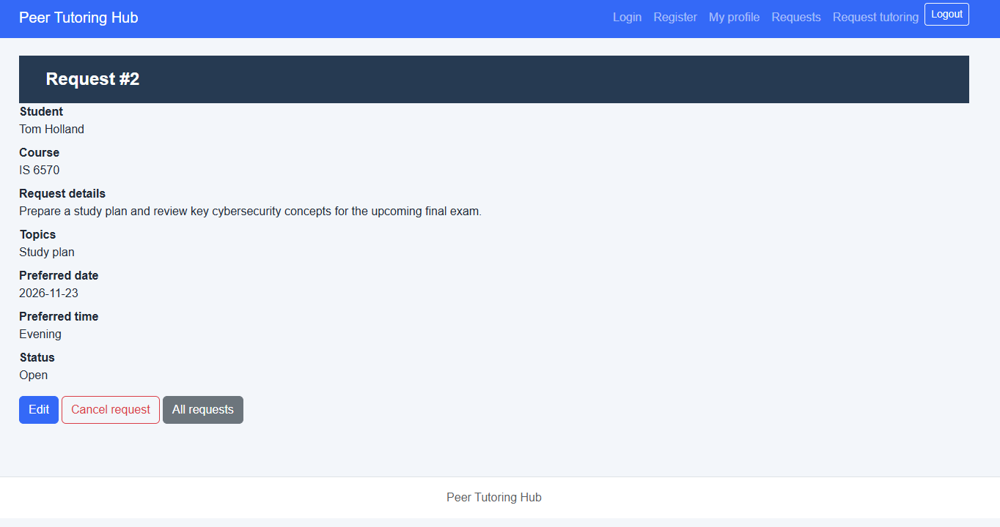
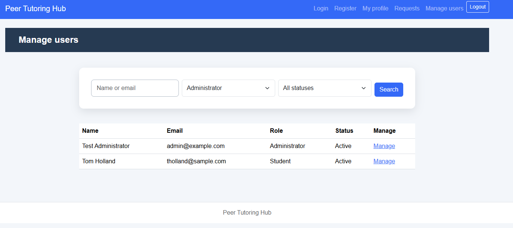

# Lab 7 Notes — Peer Tutoring Hub

## Part 1 — AI Application Generation

### 1. AI prompt used

I uploaded the Lab 6 application and the Lab 7 design and reference materials, then used this prompt:

> Generate code for all user management use cases UM-01 through UM-10 in the User Management Design Document.
>
> Use the Application Builder, Test Harness Generator, and Traceability Auditor documents as implementation guidance. Follow the authentication, authorization, session management, password hashing, CSRF protection, and role based access practices in the Authentication Reading Handout.
>
> Use lab6.zip as the existing Peer Tutoring Hub application to extend. Preserve the Lab 6 three tier architecture and update the application as needed to support user registration, login, logout, profile management, administrator access, and protected tutoring request workflows.
>
> Return a complete Lab 7 application package with all updated and new files.

### 2. Uploaded source files

1. `lab6.zip` — existing Peer Tutoring Hub application.
2. `Peer_Tutoring_Hub_User_Management_With_Diagrams.docx` — user management design document and use cases UM-01 through UM-10.
3. `IS6465_Authentication_Reading_Handout_v1.2_[16Nov2026].pdf` — authentication, sessions, and authorization guidance.
4. `application-builder(1).txt` — application implementation guidance.
5. `test-harness-generator.txt` — automated test guidance.
6. `traceability-auditor.txt` — requirements traceability and review guidance.

### 3. How Lab 7 extends Lab 6

Lab 6 allowed users to submit, view, edit, and cancel tutoring requests using PHP, PDO, and SQLite. Lab 7 builds on that application by adding user accounts, registration, login and logout, profile management, and administrator functions. It also adds security checks, including password hashing, PHP sessions, CSRF tokens, and role-based authorization. The existing tutoring request workflow is preserved but now restricts student access to their own records.

### 4. Generated code verified against the reading handout

I reviewed the generated `lab7/includes/auth.php` file and compared its `loginSession()` function with the **Start the authenticated session** section of the Authentication Reading Handout (page 4). The generated function calls `session_regenerate_id(true)` after login and stores the authenticated user's ID, role, display name, and last activity time in `$_SESSION`. This matches the handout's recommendation to regenerate the session ID after login and store a limited amount of user information on the server. I verified the presence of this code in the generated file; actual login behavior was checked separately during application testing.

```php
function loginSession(array $u): void {
    startSecureSession();
    session_regenerate_id(true);
    $_SESSION['user_id'] = (int) $u['user_id'];
    $_SESSION['role'] = $u['role'];
    $_SESSION['display_name'] = $u['full_name'];
    $_SESSION['last_activity'] = time();
    csrfToken();
}
```
---

## Part 2 — SQLite Database Setup

### 1. Database setup commands

The database setup instructions included the following commands from inside the `lab7` folder:

```bash
sqlite3 tutoring.db < setup-database.sql
sqlite3 tutoring.db < upgrade-to-user-management.sql 
php database/upgrade.php
```

These commands creates the original tutoring database tables, upgrades the database for user management.

### 2. Database table verification

After completing the setup, I checked the database tables using:

```bash
sqlite3 database/tutoring.db
.tables
```

I confirmed that the three required tables appeared: `students`, `tutoring_requests`, and `users`.

### 3. Database table output



I also ran `PRAGMA table_info(students);` and confirmed that `students.user_id` exists. A separate query confirmed that the administrator account had the `Administrator` role and `Active` status.

---

## Part 3 — Administrator Account Creation

I created a test administrator account using the provided php  administrator creation script:

```Bash
php create-admin.php "Test Administrator" admin@example.com "Password"
```

I then verified the account in SQLite. I ran:

```sql
SELECT user_id, full_name, email, role, status
FROM users
WHERE email = 'admin@example.com';
```

**Actual result:**

```text
1|Test Administrator|admin@example.com|Administrator|Active
```

The database showed that the administrator account existed, had the `Administrator` role, and was `Active`.

---

## Part 4 — Run the Application

I started the PHP application in Codespaces using:

```bash
php -S 0.0.0.0:8000 -t . php/router.php
```

The application opened through forwarded port 8000 and displayed the login form. While logged out, I tried to open `/php/profile.php`. The application returned me to the login page rather than showing the profile. **Result: Pass** for this unauthenticated-access check.

---

## Part 5 — Student Workflow Testing

I tested the Peer Tutoring Hub as a student using a test account. The table records what I did, what I expected, and what actually happened.

| Test | What I did | Expected result | Actual result | Status |
|---|---|---|---|---|
| 1. Register student | Submitted the registration form with the Student account type. | Account is created and registration confirmation appears. | The application displayed “Account created. You may now log in.” | **Pass** |
| 2. Student login | Logged in with the newly registered student credentials. | Login succeeds and the protected profile is accessible. | The application opened `/php/profile.php` and displayed Tom Holland and `tholland@sample.com`. | **Pass** |
| 3. Update profile | Changed the name from Tom Holland to Thomas Holland and saved. | The updated name is saved and displayed. | The name was updated successfully; Thomas Holland appeared on later request pages. | **Pass** |
| 4. Create request | Submitted a tutoring request for IS 6570, topic Study plan, preferred date November 23, 2026, evening. | A request is created with a unique ID and `Open` status. | Request #2 displayed the entered details and `Open` status. | **Pass** |
| 5. Edit request | Edited Request #2 to add review of key cybersecurity concepts for the final exam. | Changes save without changing request ID or `Open` status. | The updated description appeared on Request #2; its status remained `Open`. | **Pass** |
| 6. View requests | Opened the tutoring requests list after editing. | The student can see their saved request and updated information. | Request #2 appeared with Thomas Holland, IS 6570, the updated description, November 23, 2026, and `Open` status. | **Pass** |
| 7. Logout | Clicked Logout while signed in. | Session ends, browser redirects to login, and protected pages are inaccessible. | Logout function worked successfully | **Pass** |

### Logout defect and correction

When I clicked **Logout**, PHP reported:

```text
Warning: setcookie() expects parameter 4 to be string, array given
Warning: Cannot modify header information - headers already sent
```

The warnings pointed to `includes/auth.php` and `php/logout.php`. I inspected `logoutSession()` and found that the `setcookie()` call passed an options array in the wrong argument position. The recommended correction is to use the options-array form of `setcookie()` and place the expiration time inside the array:

```php
setcookie(session_name(), '', [
    'expires' => time() - 42000,
    'path' => $params['path'],
    'domain' => $params['domain'],
    'secure' => $params['secure'],
    'httponly' => $params['httponly'],
    'samesite' => $params['samesite'] ?? 'Lax'
]);
```

**Retest status:** Pass. 

### Evidence



## Part 6 – Administrator Workflow Testing

**1. What is authentication in this application?**

Authentication is the process of verifying a user's identity when they log into the Peer Tutoring Hub. The application checks the email and password entered against the account information stored in the database. Once the credentials are verified, the user can access the application based on their account.

**2. What is authorization in this application?**

Authorization determines what a user is allowed to access after logging in. The application uses different roles, such as Student and Administrator, to control access to certain pages and functions. For example, administrators can manage users, while students have access to their own profiles and tutoring requests.

**3. How is student access different from administrator access?**

Students can view and update their own profiles and create, edit, or cancel their own tutoring requests. Administrators have broader access, allowing them to view registered users, manage accounts, and view tutoring requests from different students. I verified this when my student account displayed only Request #2, while the administrator account displayed both Request #1 and Request #2.

**4. Which functions or pages should be limited to administrators?**

The Manage Users page and functions that allow changes to user roles and account statuses should be restricted to administrators. Administrators should also have access to viewing and managing tutoring requests across different student accounts. Regular students should not have permission to change another user's role, deactivate accounts, or access another student's private information.

**5. What happens after logout if a user tries to visit a protected page directly?**

After logging out, the user's authenticated session should be terminated. If the user attempts to access a protected page such as `profile.php`, the application should redirect them to the login page instead of displaying protected information. I verified this behavior during the student workflow testing after correcting an issue with the logout function.

### Administrator Screenshot

**Screenshot:** 



## Part 7 – Trace Registration and Login

### Student Registration Workflow

**1. Which file displays the Create Account form?**

The `php/register.php` file displays the Create Account form.

**2. Which file receives the submitted registration form?**

The `php/register.php` file also receives the submitted form using the POST method.

**3. Which file or function creates and verifies the CSRF token?**

The `includes/auth.php` file contains the `csrfToken()`, `csrfField()`, and `verifyCsrfToken()` functions.

**4. Which service validates the registration information?**

The `services/userService.php` file contains the `registerUser()` function. It uses `validateIdentity()` and `validatePassword()` to check the user's information.

**5. Where is the password hashed?**

The password is hashed inside the `registerUser()` function in `services/userService.php`, using PHP's `password_hash()` function with `PASSWORD_DEFAULT`.

**6. Which repository files insert user and student data?**

The `repositories/userPDO.php` file contains the `insertUser()` function, which inserts the new account into the users table.

**7. Which database tables receive records when a student registers?**

Two SQLite tables receive records:

- `users` stores the account information, including name, email, password hash, role, and status.
- `students` stores the student's name, email, and associated `user_id`.

### User Login Workflow

**1. Which file displays the login form?**

The `php/login.php` file displays the login form.

**2. Which file receives the submitted login credentials?**

The `php/login.php` file also receives the submitted login credentials using the POST method.

**3. Which repository retrieves a user by email address?**

The `repositories/userPDO.php` file retrieves user information from the SQLite database using the `findUserByEmail()` function. 

**4. Where is the submitted password verified?**

The submitted password is verified in `services/userService.php` using PHP's `password_verify()` function. The function compares the entered password against the password hash stored in the database without needing to decrypt the stored password.

**5. What session actions occur after successful login?**

After a successful login, the application calls the `loginSession()` function in `includes/auth.php`. This function starts a secure session, regenerates the session ID, and stores the user's ID, role, display name, and last activity time in the session.

**6. Why should the application regenerate the session ID after login?**

Regenerating the session ID helps prevent session fixation attacks. If an attacker obtained or controlled a session ID before login, regenerating it makes that previous ID unusable for the newly authenticated session. This adds another layer of security to the application.

**7. How does the application determine whether the logged-in user is a student or administrator?**

The application retrieves the user's role from the `users` table in the SQLite database. The role is stored in the session after login. Functions such as `requireRole()` in `includes/auth.php` use this information to determine which pages and actions the user is authorized to access. Students are limited to their own tutoring requests, while administrators can access user-management functions and requests from different students.

### Why Password Hashing and Verification Belong in the Application Layer

Password hashing and verification should occur in the application layer because this is where the authentication and business logic are handled. Keeping these functions in the service layer separates security processing from the presentation pages and database setup scripts. The database should store password hashes rather than plain-text passwords, reducing the risk of exposing actual passwords if the database is compromised.

## Part 8 – Run the Automated Tests

### Test Group 1: Validation Tests

**Command:**

```bash
php tests/validation-tests.php
```

**Complete Terminal Output:**

```text
Xdebug: [Step Debug] Could not connect to debugging client. Tried: localhost:9000 (through xdebug.client_host/xdebug.client_port) :-(
<p>Valid time: PASS</p><p>Missing time: PASS</p><p>Altered value: PASS</p><p>Multiple valid topics: PASS</p><p>Missing topics: PASS</p><p>Altered topic: PASS</p><p>Minimum length: PASS</p><p>Maximum length: PASS</p><p>Too short: PASS</p><p>Too long: PASS</p>
Validation failures: 0
```

**Test Result: Pass – 10 passed, 0 failed.**

### Test Group 2: User Management Tests

**Command:**

```bash
php tests/user-management-tests.php
```

**Complete Terminal Output:**

```text
Xdebug: [Step Debug] Could not connect to debugging client. Tried: localhost:9000 (through xdebug.client_host/xdebug.client_port) :-(
PASS UM-01 student active
PASS UM-01 password hashed
PASS UM-01 public administrator denied
PASS UM-01 duplicate rejected
PASS UM-01 linked student profile
PASS UM-01 tutor registration
PASS UM-09 valid login
PASS UM-09 invalid password denied
PASS UM-04 profile update
PASS UM-04 linked profile synchronized
PASS UM-04 duplicate email denied
PASS UM-05 new password only
PASS UM-05 incorrect current password denied
PASS UM-03 administrator search repository
PASS UM-07 inactive login denied
PASS UM-06 role update
PASS UM-08 deletion blocked pending policy
PASS UM-07 multiple administrators allow deactivation
PASS UM-07 last active admin protected
PASS Student owns created request
PASS Another user cannot read request
PASS Non-student cannot create request
PASS Other user cannot edit request
PASS Other user cannot cancel request
PASS Ownership-filtered listing
Results: 25 passed, 0 failed
```

**Test Result: Pass – 25 passed, 0 failed.**

### Test Group 3: Integration Tests

**Command:**

```bash
php tests/integration-tests.php
```

**Complete Terminal Output:**

```text
Xdebug: [Step Debug] Could not connect to debugging client. Tried: localhost:9000 (through xdebug.client_host/xdebug.client_port) :-(
PASS UC01 Create and Open
PASS Lab 4 checkbox values preserved
FAIL Duplicate email reuses student
FAIL UC02 course and status filter
PASS Invalid reason rejected
FAIL Invalid submission writes nothing
PASS Edit Open request
PASS Updated reason persisted
PASS Cancel Open request
PASS Cancelled row retained
PASS Second cancellation rejected
PASS Unrelated request unchanged
PASS FK enforced
PASS UC02 empty filter result
FAILURES: 3
```

**Test Result: Fail – 11 passed, 3 failed.**

The integration tests verified how the application's services, repositories, and SQLite database work together. Most tests passed, including request creation, editing, cancellation, foreign key enforcement, and several validation checks.

However, three integration tests failed and require further investigation.

### Failed Integration Test Investigation

**1. Failed Test: Duplicate email reuses student**

**What the Test Checks:** This test checks whether the application reuses an existing student record when the same email address is submitted instead of creating a duplicate student record.

**Possible Issue:** The student repository or the relationship between the `students` and `users` tables may need further investigation. The failure could involve how existing student records are identified or reused.

**2. Failed Test: UC02 course and status filter**

**What the Test Checks:** This test checks whether the application correctly filters tutoring requests based on the selected course and request status.

**Possible Issue:** The request repository's filtering logic may need further investigation to determine why the expected records were not returned. The SQL query or the way filter values are passed between the application layers could be contributing to the failure.

**3. Failed Test: Invalid submission writes nothing**

**What the Test Checks:** This test verifies that invalid tutoring request submissions do not create or modify database records.

**Possible Issue:** The request validation service and database transaction handling may need further investigation. It is possible that a database operation occurs before all validation checks are completed, or that the test detects an unexpected database change.

## Part 9: Use the AI Skills Pack Process

### Application Builder

**AI Prompt:**

Explain how a student registration request moves from register.php through authentication checks, PHP services, repositories, PDO, and SQLite in the Peer Tutoring Hub application. Identify the responsibility of each file or layer.

**AI Response:**

The Peer Tutoring Hub application uses a three-tier architecture to separate the presentation layer, business logic, and database operations.

The registration process begins in `php/register.php`, which displays the Create Account form and receives the submitted information through a POST request.

The `includes/auth.php` file provides security functions that generate and verify CSRF tokens. These tokens help protect the application against unauthorized form submissions.

Next, `services/userService.php` handles the registration logic. It validates the user's name, email, password, and selected role. It also checks for duplicate accounts and hashes the password using PHP's `password_hash()` function.

The `repositories/userPDO.php` file handles user database operations through PDO. The database connection is established through `config/db.php`, which connects the application to SQLite.

Finally, the account information is stored in the `users` table, and a linked student record is created in the `students` table.

One implementation detail is that the registration service directly inserts the student record using a prepared SQL statement rather than delegating that operation to the student repository.

**My Evaluation:**

I selected the AI statement that the application uses CSRF protection during registration.

I reviewed the `includes/auth.php` file and confirmed that it contains the `csrfToken()` and `verifyCsrfToken()` functions. The `csrfToken()` function generates a random token and stores it in the session, while `verifyCsrfToken()` compares the submitted token against the stored token using `hash_equals()`.

This confirms that the application contains the CSRF protection functions described by the AI.

---

### Traceability Auditor

**AI Prompt:**

Trace the requirement "a student can register, log in, create a tutoring request, and log out" through the presentation pages, authentication code, services, repositories, SQLite tables, and automated tests in this project.

**AI Response:**

The Peer Tutoring Hub uses presentation pages, authentication functions, service-layer validation, PDO repositories, and SQLite tables to support registration, login, tutoring requests, and logout.

The following table traces each requirement through the application and identifies the supporting test evidence.

**Traceability Table:**

| Requirement | Presentation Page | Authentication or Authorization | Service or Validation | Repository or SQL | Database Table | Test Evidence |
|---|---|---|---|---|---|---|
| Student registers an account | `php/register.php` | `includes/auth.php` — CSRF protection | `userService.php` — `registerUser()` | `userPDO.php` and student INSERT in service | `users`, `students` | UM-01 tests passed |
| Student logs in | `php/login.php` | `loginSession()` in `includes/auth.php` | `userService.php` — password verification | `userPDO.php` — `findUserByEmail()` | `users` | UM-09 tests passed |
| Student creates a tutoring request | `php/request-form.php`, `php/process-request.php` | `requireLogin()`, `requireRole()`, `verifyCsrfToken()` | `requestService.php` — `submitAuthenticatedRequest()` | `requestPDO.php` — `insertTutoringRequest()` | `students`, `tutoring_requests` | UC01 and ownership tests passed |
| User logs out | `php/logout.php` | `logoutSession()` in `includes/auth.php` | Session cleanup | No repository write required | No direct database update | Manual logout retest passed |

---

### Test Harness Generator

**AI Prompt:**

Suggest one useful test case for authentication or authorization in the Peer Tutoring Hub application. The test must relate to registration, login, logout, session protection, role based access, password validation, CSRF protection, or account status.

**AI Response:**

The AI suggested testing whether a user can access a protected page after logging out.

**Suggested Test:** AUTH-01 — Protected Page Access After Logout

**Test Objective:** Verify that the application terminates the authenticated session after logout and prevents access to protected pages.

**Test Steps:**

1. Log in using an active student account.
2. Navigate to the My Profile page.
3. Click Logout.
4. Attempt to access `/php/profile.php` directly through the browser.
5. Verify that the application redirects to the login page without displaying protected information.

**Expected Result:** The application should redirect the user to the login page because the authenticated session has ended.

**1. Is this test already covered?**

I reviewed the automated test results from Part 8. The user management tests included login validation, account status checks, and role-based access restrictions.

However, none of the displayed test results specifically verified access to a protected page after logout. Based on the available output, this scenario does not appear to have an explicitly identified automated test. The test source code would need to be reviewed to confirm whether it is already covered.

**2. How would I test it manually or automatically?**

I would manually log in using a student account, open the profile page, and then log out. After logging out, I would enter the profile page URL directly into the browser to verify that the application redirects me to the login page.

For an automated test, I would verify that the session is destroyed after logout and that a subsequent unauthenticated request to a protected page is redirected to the login page.

**3. Is the AI-generated test appropriate?**

Yes, I believe this is an appropriate test because the application uses PHP sessions to control access to protected pages.

During Part 5, I encountered an issue with the logout function that required correcting the `setcookie()` call in `includes/auth.php`.

Although the logout function worked after the correction, testing direct access to protected pages would provide additional evidence that session management is functioning correctly.

This test would help ensure that users cannot continue accessing protected account information after logging out.

---

### Skills Pack Reflection

Using the AI tool helped me better understand how the different PHP files work together throughout the application, especially how information moves between the presentation, service, and database layers. It also helped me trace the registration and login processes and identify which files were responsible for authentication and authorization. During testing, AI helped me understand the errors I encountered, including the logout issue and the three failed integration tests. I learned that developers should not rely completely on AI-generated explanations or code because AI can make incorrect assumptions or overlook important details. It is important to compare AI responses against the actual requirements, source code, and test results to make sure the application works as intended.

## Part 10: Inspect the Database

### Database Inspection

**Command used:**

```bash
sqlite3 database/tutoring.db
```

**SQL Query:**

```sql
SELECT
    u.user_id,
    u.full_name,
    u.email,
    u.role,
    u.status,
    s.student_id,
    s.student_name,
    s.student_email
FROM users AS u
LEFT JOIN students AS s
    ON u.user_id = s.user_id
ORDER BY u.user_id;
```

**Query Results:**

```text
1|Test Administrator|admin@example.com|Administrator|Active|||
2|Tom Holland|tholland@sample.com|Student|Active|2|Tom Holland|tholland@sample.com
```

**Result:** Pass

The query successfully returned two user accounts. The administrator account did not have a matching student profile, while the student account had a matching record in the `students` table.

### Database Questions

**1. What does the LEFT JOIN do in this query?**

The `LEFT JOIN` combines information from the `users` and `students` tables based on their matching `user_id`. It returns all records from the `users` table, even when there is no matching record in the `students` table. If there is no matching student record, the student information appears as NULL.

**2. How does the users table connect to the students table?**

The two tables are connected through the `user_id` column. The `users` table stores the main account information, while the `students` table uses `user_id` to link a student profile to the correct account. In my query results, Tom Holland has a user ID of 2, which connects to his student profile. This allows the application to retrieve the correct student information.

**3. Why does the application store account information separately from student profile information?**

The application separates account information from student profile information to keep the database organized and reduce unnecessary duplication. The `users` table stores information needed for authentication and account management, such as email, password hash, role, and status. The `students` table stores information related specifically to the student's profile. This separation makes it easier to support different account roles without requiring every user to have a student profile.

**4. Why may an administrator account not have a matching row in the students table?**

An administrator account may not have a matching student record because administrators have a different role in the application. Their main responsibility is to manage users and oversee tutoring requests rather than submit requests as students. In my query results, the Test Administrator account appeared with no matching student information, which demonstrates how the `LEFT JOIN` works.